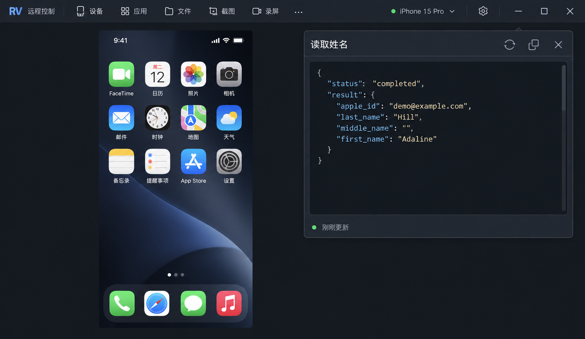

# 原始查询结果设计 v2

工具：内置 imagegen。

保留完整原始 JSON，默认展开，不解析业务字段、不隐藏空值。标题栏提供刷新、复制和关闭图标；结果区等宽字体、缩进与轻量语法高亮，可滚动。目标面板宽 360px、高度随结果在窗口可用高度内调整；图标 14px、点击区域 24px。图中的工具栏和手机仅作背景示意，实施保留 RV 既有布局。此版本替代 v1 的字段展示方向。



## 完整生成提示词

```text
Use case: ui-mockup.
Generate a high fidelity design screenshot of the RV desktop remote iPhone client, focusing on a compact RAW JSON query result popover. The user explicitly wants to read the original full return value, NOT a parsed field/value UI. Keep the raw response front and center and open by default.
Visual style must match RV's established restrained charcoal theme: flat #202730 popover, #171d24 code area, subtle #39414b one-pixel border, 7px corners, off-white text, muted gray secondary text, restrained pale blue accent. No glass, glow, gradient panels or dramatic shadows. Chinese system UI font 12px, heading 13px semibold, JSON monospaced 11px with 17px line height. Small consistent outline icons 14px in 24px hit targets. Actual compact dimensions: popover 360 logical px wide and 310 logical px tall, in a 1000x580 logical px RV window, uniformly rendered at 2x. All interface elements have realistic compact proportions.
Composition: real flat desktop app screenshot, slim 32px charcoal toolbar on top with small 15px icons and a few 24px App icons. Partial remote iPhone home screen on the left, no decorative device bezel. Single result popover anchored near upper right. The phone is subdued backdrop; popover is the focus.
Popover design:
One tight 34px header with exact Chinese title “读取姓名” at left. At right, three equally sized thin outline icon actions: refresh circular arrow, copy overlapping squares, close X. No text-labeled buttons, no floating central “刷新”.
Immediately below header, a unified clean scrollable dark code pane inset 8px, filling most of the popover height. Render the COMPLETE original JSON response exactly as shown below, including status, result, and all fields even empty ones. Syntax highlighted gently: keys muted light blue, strings off-white with slight warm tint, punctuation muted gray. Two-space indentation, plenty of contrast, consistent monospaced text; all lines readable with no clipped values and no misleading fabricated fields. Keep the code as raw JSON, with braces, commas and quotes. Do not turn it into rows, forms or tiles. Allow scrollbar as a thin subtle vertical line at right; no line-number gutter required.
Exact raw JSON:
{
  "status": "completed",
  "result": {
    "apple_id": "demo@example.com",
    "last_name": "Hill",
    "middle_name": "",
    "first_name": "Adaline"
  }
}
A tiny subdued 22px footer underneath the code area, green 5px dot then “刚刚更新” on left. No duplicated “已读取” row, no “收起详情” or “详情” toggle, no raw-data link, no execution/cancellation confirmation, no text input. The raw result is always visible. No giant success check, big avatar, parsed name fields, summary card, designer annotations, marketing copy, badges or watermark.
Focus on elegant spacing and consistent tool icon sizes; the result should feel like a lightweight native developer-data popover integrated into the existing RV app.
```

