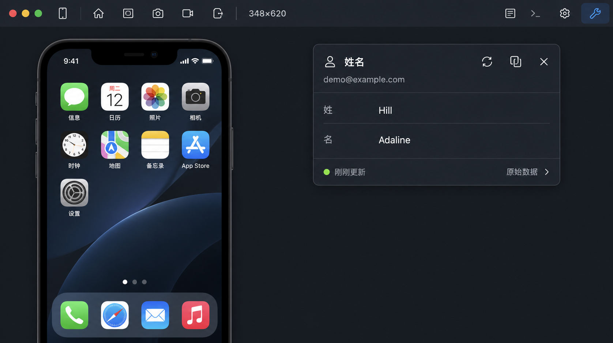

# 查询结果设计 v1

工具：内置 imagegen。

设计方向：紧凑深色结果面板，姓名等结果直接按字段显示；刷新、复制、关闭收进标题栏，空字段隐藏；原始数据折叠。图中工具栏和手机仅作背景参照，实施保留现有结构。面板目标宽度 360px，图标 14–15px，按钮点击区域 24px。



## 生成提示词

```text
Use case: ui-mockup.
Create a polished, implementable UI design image for the RV desktop remote-iPhone client, focusing on a compact query RESULT popover. Flat front-on software screenshot, sharp Chinese typography, restrained utilitarian dark interface. Landscape image.
The established UI has a charcoal toolbar and popovers (#202730), almost-white text, muted gray labels, small blue accent, subtle 1px gray border, 8px corner radius. Show enough of the application window to judge the REAL compact proportions: slim 32px toolbar across the top, remote iPhone screen partially visible on the left, one small query popover near the upper right, only 360 logical pixels wide, around 230 logical pixels tall, in a 1000x560 logical-pixel app window. All rendered uniformly at 2x scale. No huge buttons, no oversized icons, no dashboard cards.
Redesign the screenshot's ugly query panel into a readable result surface. The query has already executed automatically; show the returned name immediately as normal UI data. Exact visible popover content:
Header: small 14px user outline icon and title “姓名” (13px semibold), right side refresh outline icon, copy outline icon, close X, each 14px icon in a 24px hit area, all same weight.
Under header: muted 11px account context “demo@example.com”, without a redundant account field row.
Two clean label/value rows with aligned columns and 30px row height: “姓” on left and “Hill” on right; “名” on left and “Adaline” on right. Labels subdued gray 11px, values white 12px medium. Comfortable but tight alignment, light separators only where useful. Omit empty middle-name field.
Footer separated by subtle line: tiny green dot and “刚刚更新” muted 10px on left, “原始数据” with tiny chevron on right as a quiet tertiary disclosure. Raw JSON is collapsed and never dominates the normal result.
The entire surface is compact, clear, reusable for other read-only result types. No “已读取” success row, no center-aligned “刷新” text button, no execute/cancel confirmation buttons, no input fields, no large checkmark, no JSON/code block, no big decorative avatar or portrait.
Toolbar: small consistent 15px outline icons and 24px App icons, a small selected wrench icon at the right, resolution text “348×620”; no large labels or search.
Remote phone screen is subordinate and dim, with a few familiar iOS app icons, not detailed personal data. The main focus is the elegant compact query result panel. Do not add design explanations, headings, annotations, marketing copy or watermarks. This should look like a real native desktop app implementation, not a conceptual giant web dashboard.
```

